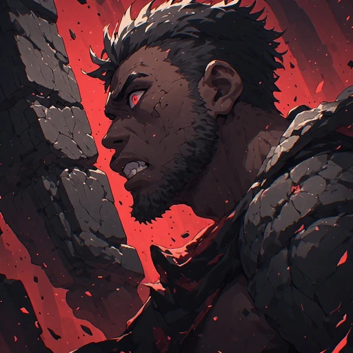
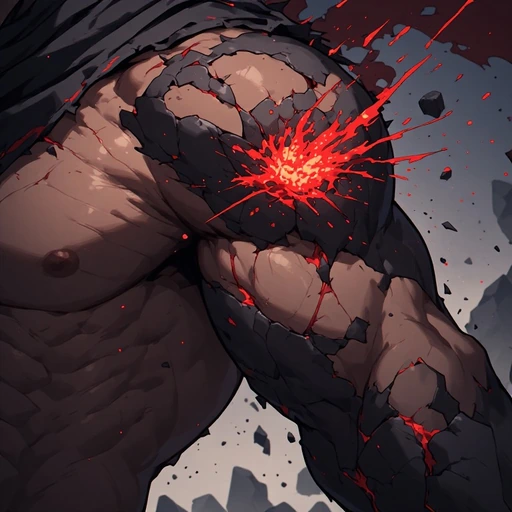
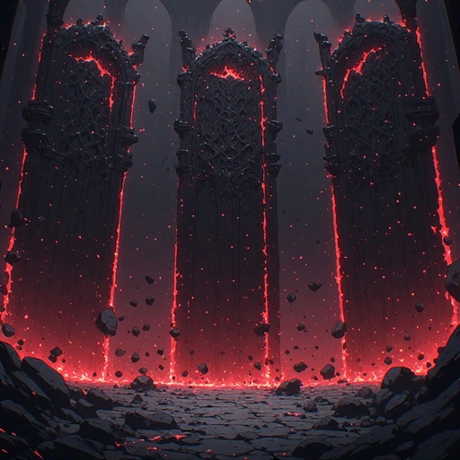
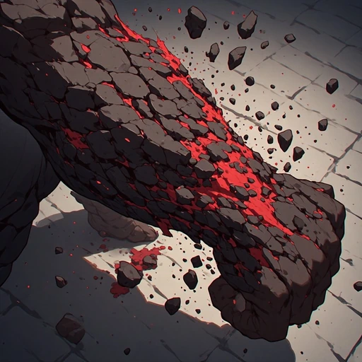
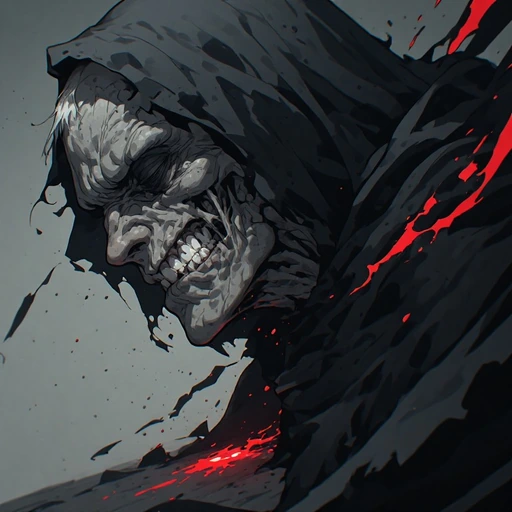
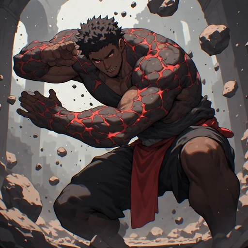

> **Registro histórico.** Nomes, títulos, contagens, regras e direções visuais deste relatório refletem sua etapa de produção. Para o estado vigente, consulte [o índice canônico](PROJECT_CANON.md), [o catálogo atual](CHARACTER_CATALOG.md) e [a direção de arte](ART_DIRECTION.md). IDs e caminhos antigos permanecem por compatibilidade.

# Atlas — kit anime 2.5D

Seis artes aprovadas para Inferno / Magma, com composições distintas e preservação da identidade definida pelo retrato. A técnica de equipe é ambiental; na cena de controle, o ghoul ocupa o primeiro plano e Atlas permanece fora do quadro.

## Retrato

## Peso Acumulado

## Ombro do Mundo

## Peso sem Medida

## Colapso de Autoridade

## Sustentar o Céu

Proveniência, sementes, hashes e prompts: [manifesto JSON](ART_ATLAS_ANIME_FIRST_COMPLETION_20261029.json).

