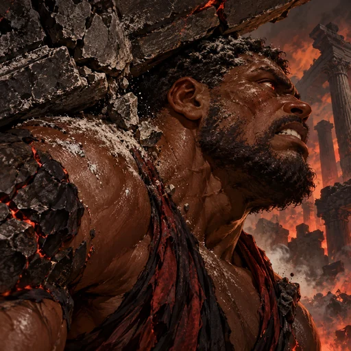
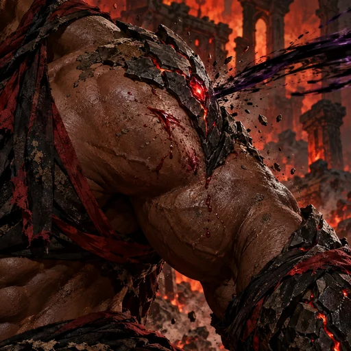
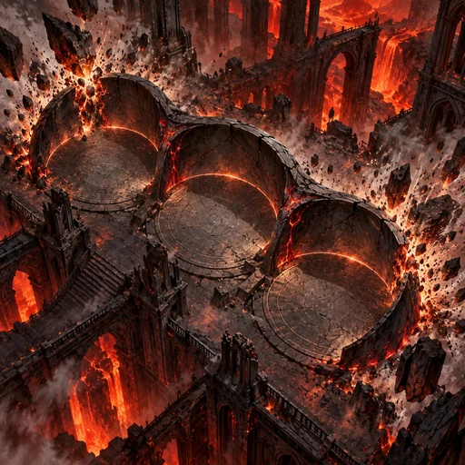
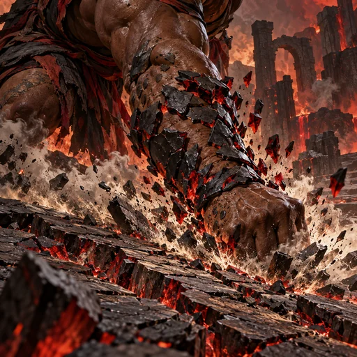
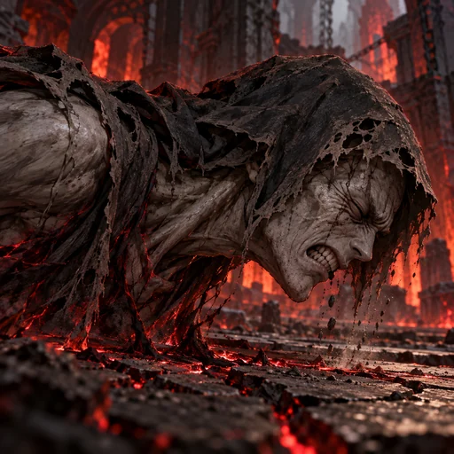
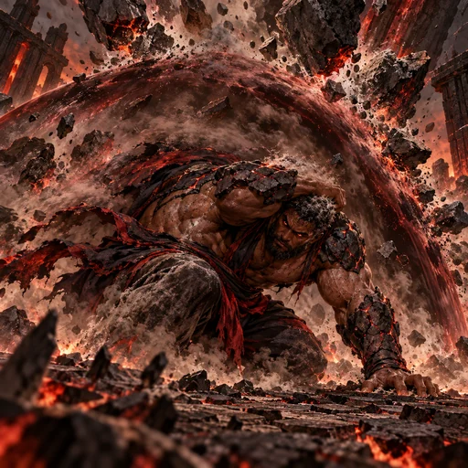

# Atlas — reformulação dark fantasy pictórica (2026-10-29)

**Mundo:** Inferno · **Reino:** Magma

## Identidade

Titã humanoide muito robusto, pele castanho-escura viva, rosto largo de traços africanos, nariz achatado, maxilar pesado e barba curta, cabelo negro curto coberto por poeira mineral clara, olhos vermelho-ocre. Placas orgânicas de basalto concentradas apenas nos ombros e antebraços, fissuras vermelhas discretas e faixas de tecido ritual preto e vermelho-escuro. A pele continua humana; não usa armadura nem tecnologia.

## Direção

Dark fantasy pictórica densa, texturizada e material, com pincelada estilizada, desgaste e realismo reduzido. A referência orienta somente o tratamento visual; não copiar seu personagem, tema ou composição. Efeitos se manifestam de modo físico e coerente. Sem tecnologia ou maquinaria.

## Kit

- **Retrato:** Atlas sustenta uma verga quebrada de basalto sobre o ombro; em perfil, encara a rachadura enquanto o corpo reage ao esforço.
- **Peso Acumulado (passiva):** Após receber um golpe, a pele ferida e o recuo do músculo mostram perda de Vida; uma nova placa de basalto surge e uma carga rubra se forma.
- **Ombro do Mundo (impulso):** Três zonas de abrigo interligadas detêm pedras em queda; cada zona protege um espaço aliado.
- **Peso sem Medida (técnica):** O antebraço golpeia o chão e consome a crosta de Defesa em uma ruptura física do basalto.
- **Colapso de Autoridade (voto):** Um ghoul reage involuntariamente à pressão; Atlas fica fora de quadro.
- **Sustentar o Céu (despertar):** Atlas se agacha sob pedras em queda e desvia escombros com uma película de pressão, poeira e cinzas.

## Galeria

### Retrato

### Peso Acumulado

### Ombro do Mundo

### Peso sem Medida

### Colapso de Autoridade

### Sustentar o Céu

Os ativos WebP têm 512 × 512; as fontes JPEG têm 768 × 768. Hashes e cenas estão no manifesto JSON. As seis peças permanecem candidatas e aguardam revisão visual final.
