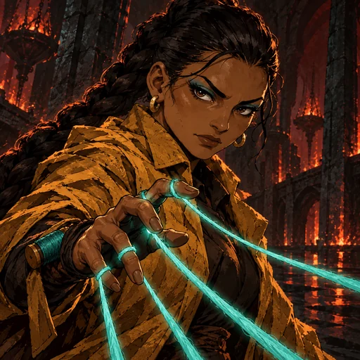
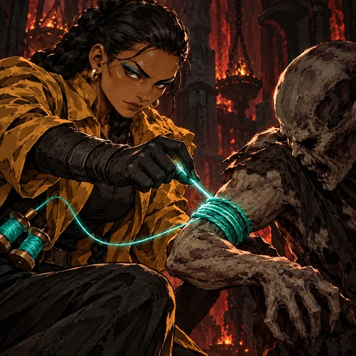
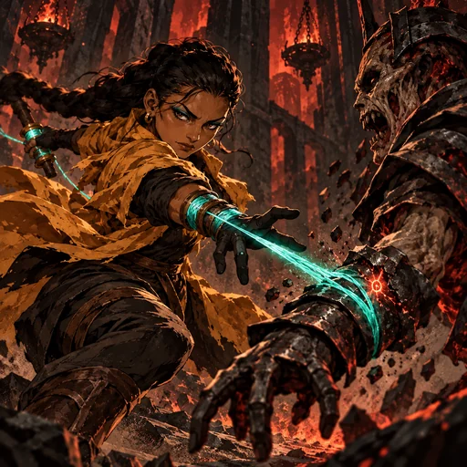
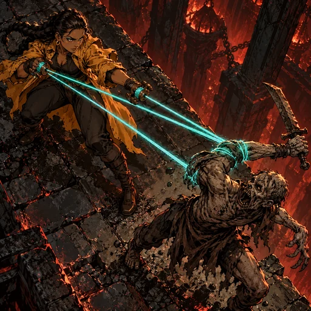
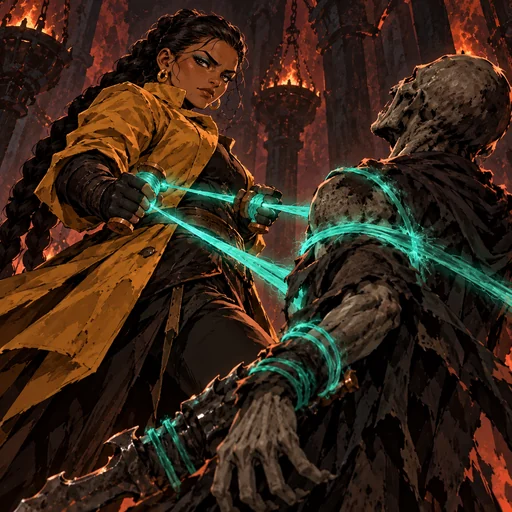
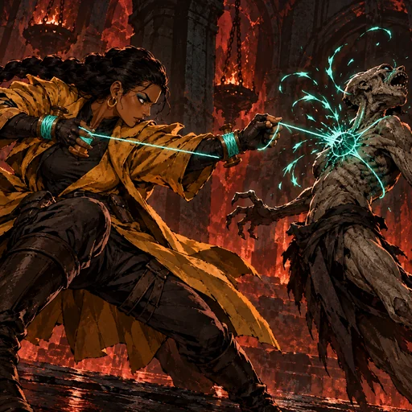
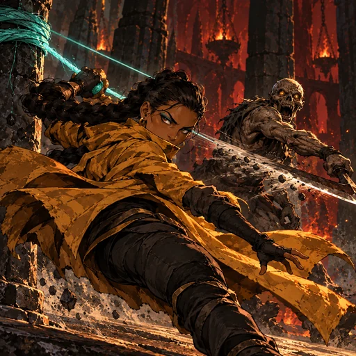

> **Registro histórico.** Nomes, títulos, contagens, regras e direções visuais deste relatório refletem sua etapa de produção. Para o estado vigente, consulte [o índice canônico](PROJECT_CANON.md), [o catálogo atual](CHARACTER_CATALOG.md) e [a direção de arte](ART_DIRECTION.md). IDs e caminhos antigos permanecem por compatibilidade.

# Liora — A Marionetista

Revisão dark fantasy pictórica em 31/10/2026. A identidade preserva pele morena quente, tranças longas, casaco âmbar ajustado e carretéis teal simples de madeira e bronze. Sete imagens foram geradas com OpenAI ImageGen: seis espaços-base e uma arte exclusiva para a forma **Manter o Comando**. As imagens estão integradas ao runtime; todas aguardam aprovação visual. Mecânicas preservadas.

| Espaço | Cena | Ativo |
|---|---|---|
| Retrato | Close baixo em três quartos, com fios passando entre os dedos. |  |
| Passiva | Fio preso a um alvo marcado baixa seu cotovelo e enfraquece a guarda. |  |
| Fio Nervoso | Fibra se fixa ao pulso de um ghoul e deixa a Marca Nervosa. |  |
| Puxar a Vontade | Vista elevada; fios desviam a arma de um alvo marcado. |  |
| Manter o Comando | Plano reverso baixo; ligação sustentada mantém a mesma vítima imobilizada. |  |
| Romper o Comando | A ligação estala e um alvo recua sem ferimento gráfico. |  |
| Fios Fora de Fase | Liora usa a tensão de um fio ancorado para sair da linha da lâmina. |  |

As cenas usam um ghoul por ação individual. Os fios são materiais e mostram pontos de contato claros; não há tecnologia nem ferimentos gráficos. Fontes JPEG 768 × 768: `art/source/a-marionetista-de-nervos-dark-pictorial-rework-20261031`.

## Prompt set

**Base comum:** Dark fantasy pictorial 2.5D, dense angular brushwork, inked contours, hatching, cut shadows, tactile worn cloth, basalt and coarse physical fibers. Preserve Liora: athletic adult woman around 35, warm brown skin, long black braids, amber fitted coat, ordinary five-fingered hands, small teal wrist bobbins of wood and bronze. Inferno/Carne uses ember-red and black with teal as a controlled accent. Threads must be thick physical fibers with clear attachment and tension, never thin energy beams. No gore, extra limbs, text, watermark, gears, technology or generic soldiers.

**Retrato:** Low three-quarter close portrait; determined face, braids, amber coat, fibers running through her fingers.

**Passiva:** Macro side view; tighten a fiber already attached to one marked ghoul's wrist, lowering its elbow to show Weakening.

**Fio Nervoso:** A taut fiber snaps onto exactly one ghoul's armored wrist and leaves a spiritual mark by contact.

**Puxar a Vontade:** High overhead diagonal; on one marked ghoul, attached fibers pull the weapon arm out of line and interrupt movement.

**Manter o Comando:** Reverse low view; Liora maintains tension on two fibers while the same marked victim remains immobilized, showing sustained command.

**Romper o Comando:** Extreme side profile; she snaps the prepared link and one ghoul recoils in pain, without visible injury.

**Fios Fora de Fase:** Rear three-quarter personal defense; an anchored fiber slings her intact body sideways out of one blade's path.

