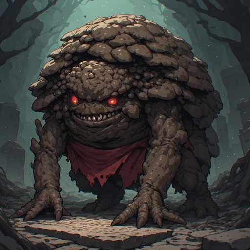
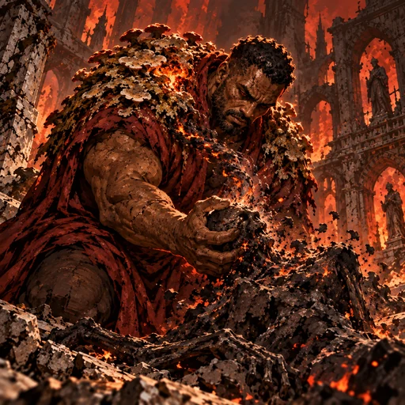
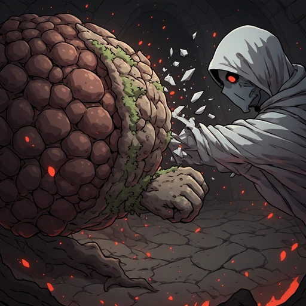
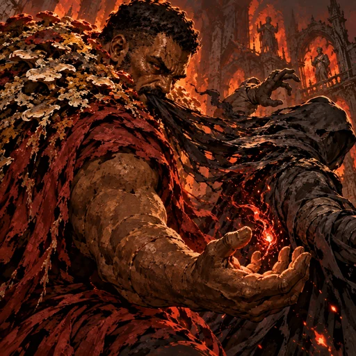
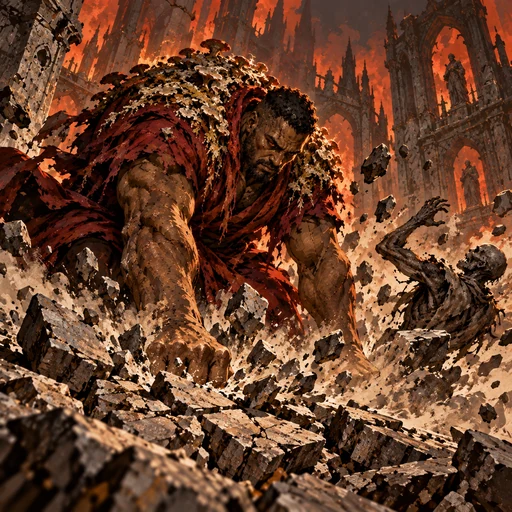
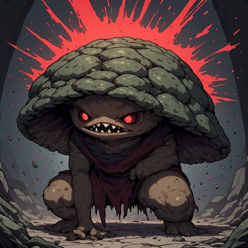

# Bulkir — kit anime 2.5D

Anime 2.5D pictórico, contornos definidos, sombras densas, atmosfera gótica ornamental e energia shonen; Inferno em preto, vermelho intenso, cinza e pedra queimada, com tons terrosos podres para o Reino Pútrido. Identidade baseada no retrato aprovado; sem alteração de forma.

## Retrato

## Passiva: Fome de Nomes

## Punho que Apaga

## Mordida de Identidade

## Esmagar o Último Vestígio

## Carapaça Faminta

Proveniência, sementes, prompts, hashes e decisões de revisão: [manifesto JSON](ART_BULKIR_ANIME_FIRST_COMPLETION_20261029.json).
