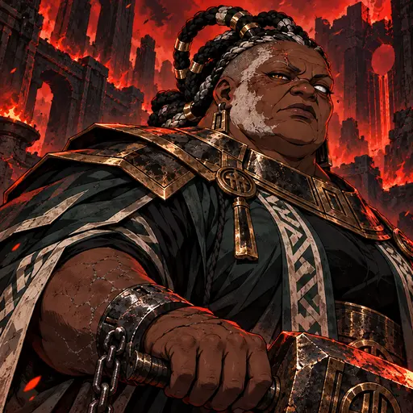
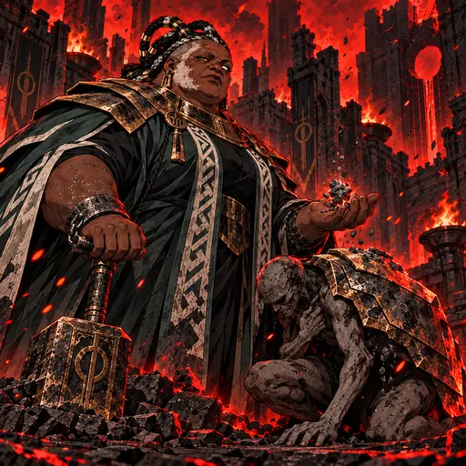
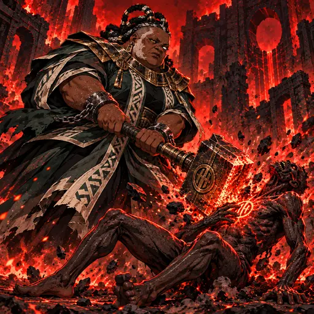
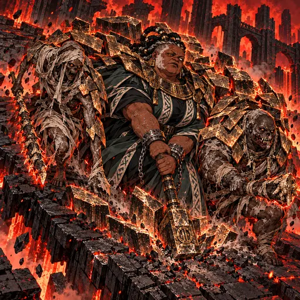
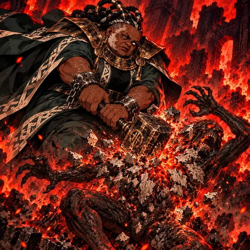
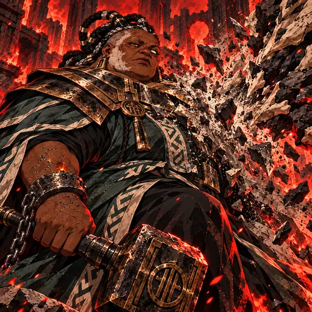

> **Registro histórico.** Nomes, títulos, contagens, regras e direções visuais deste relatório refletem sua etapa de produção. Para o estado vigente, consulte [o índice canônico](PROJECT_CANON.md), [o catálogo atual](CHARACTER_CATALOG.md) e [a direção de arte](ART_DIRECTION.md). IDs e caminhos antigos permanecem por compatibilidade.

# A Déspota — direção gráfica dark fantasy 2.5D (2026-10-29)

**Mundo:** Inferno · **Reino:** Magma

## Identidade

Amanirenas é uma matriarca idosa e colossal, de pele castanho-carvão, rosto largo envelhecido, placas pálidas de cinza na têmpora e mandíbula esquerdas, cicatriz antiga sobre a sobrancelha esquerda, olho esquerdo leitoso e opaco e olho direito âmbar menor e afiado. Laterais raspadas e três arcos altos de tranças grossas pretas e prateadas presos num nó baixo. Pescoço e braços volumosos, rachaduras de cinza resfriada nos antebraços. Usa gola e ombreiras de bronze enegrecido, casaco cerimonial verde-ardósia com geometria marfim, manto rígido trapezoidal e algemas de ferro. Mãos nuas largas com cinco dedos. Empunha um martelo imperial de marcação. A identidade física não foi alterada.

## Direção

Pintura dark fantasy densa e tátil em 2.5D, com pinceladas angulares, contornos manuais, hachuras, sombras de corte e contraste gráfico. A referência informa apenas o tratamento visual; não copiar personagem, tema nem composição. O cenário de Magma usa preto, vermelho intenso, brasas e tons queimados, mantendo a paleta própria de bronze enegrecido, verde-ardósia e marfim. Sem tecnologia ou maquinaria.

## Kit

- **Retrato:** Amanirenas escuta um tumulto fora de quadro e gira a cabeça sob o peso do martelo entre ruínas de Magma.
- **Lealdade pelo Medo (passiva):** uma placa de bronze e cinza protege um ghoul; um fragmento compacto de Cinza cai na palma da Regente.
- **Ferro do Jugo (impulso):** o martelo imperial deixa uma marca de brasa no peito de um ghoul e parte o basalto.
- **Ordem Absoluta (técnica):** dois vassalos distintos recebem placas físicas de bronze e cinza junto com Amanirenas; o trio avança.
- **Esmagar a Resistência (voto):** o martelo rompe primeiro uma crosta natural de cinza e osso; a marca de queimadura do alvo se intensifica.
- **Privilégio Soberano (despertar):** um manto espesso detém o golpe recebido, enquanto as fissuras ativas na pele da Regente continuam visíveis.

## Galeria

### Retrato

### Lealdade pelo Medo

### Ferro do Jugo

### Ordem Absoluta

### Esmagar a Resistência

### Privilégio Soberano

As seis peças são candidatas integradas e aguardam aprovação visual final.

