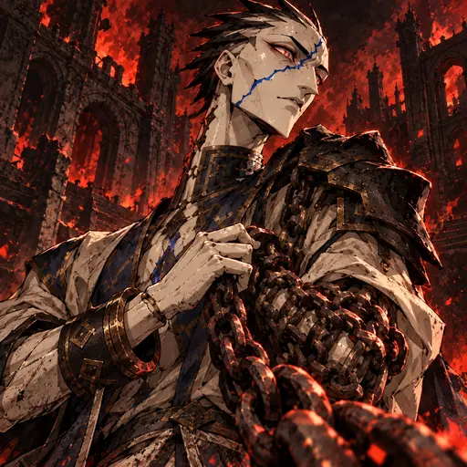
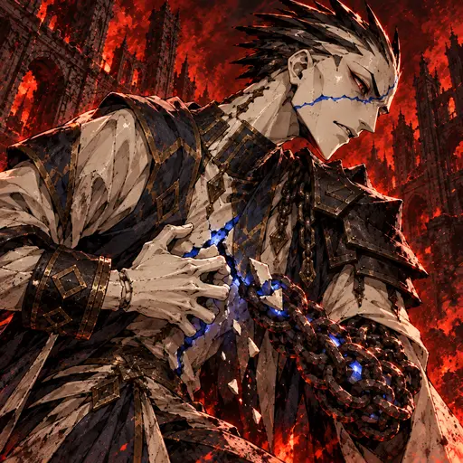
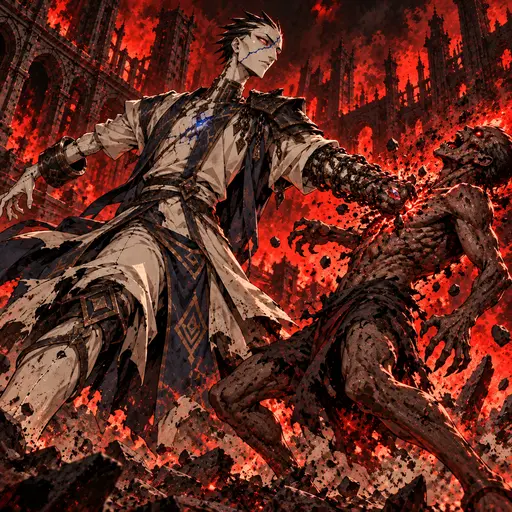
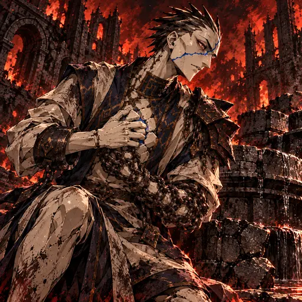
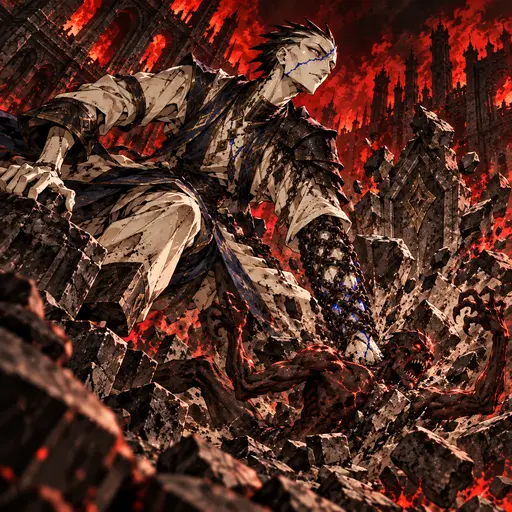
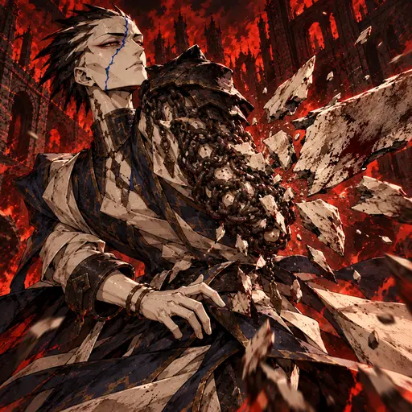

# O Herdeiro Cativo — direção gráfica dark fantasy 2.5D (2026-10-29)

**Mundo:** Inferno · **Reino:** Magma

## Identidade

Efígie imperial de porcelana viva que abriga uma alma dinástica; corpo extremamente alto e estreito, pescoço longo e articulações angulares mas coerentes. Rosto de cerâmica marfim com nariz adunco, boca assimétrica, sobrancelhas pretas incisas e dois olhos pequenos carmesim com pupilas brancas horizontais. Fratura azul-cobalto diagonal da bochecha direita à testa esquerda. Crista baixa assimétrica de espinhos curtos de porcelana negra, sem cabelo humano. Braço direito de porcelana intacta; antebraço esquerdo em treliça contínua de elos de ferro ao redor de núcleo cerâmico, mão de porcelana com cinco dedos. Túnica dinástica rígida marfim e azul-ardósia, ombreira negra no lado esquerdo, golas geométricas e manilhas. Sem coroa.

A alma dinástica e ressentida habita a efígie; ela não tem cabelo humano, coroa ou pele viva. Sua anatomia permanece alta, estreita e articulada, com dois braços e duas pernas coerentes.

## Direção

Pintura dark fantasy densa e tátil em 2.5D, com pinceladas angulares, contornos manuais, hachuras, sombras de corte e contraste gráfico. A referência informa apenas o tratamento visual; não copiar personagem, tema nem composição. Inferno usa preto, vermelho intenso e brasas; o cobalto permanece como marca pessoal da porcelana. Sem tecnologia ou maquinaria.

## Kit

- **Retrato:** Arminius reage ao ruído das correntes e as puxa contra o peito.
- **Ambição Acorrentada (passiva):** um fragmento cerâmico se solta e prende na treliça do antebraço esquerdo como carga; a rachadura permanece aberta.
- **Punho Acorrentado (impulso):** o punho esquerdo golpeia um ghoul com um eixo de força claro.
- **Resistência do Pretendente (técnica):** o personagem pressiona fragmentos ao esterno e usa o antebraço de correntes como tala física.
- **Tomada do Trono (voto):** o punho descarrega as cargas num alvo e parte o relevo de pedra; uma fratura nova marca o custo.
- **Guarda Dinástica (despertar):** a treliça de correntes e porcelana detém um golpe, sem apagar fraturas antigas.

## Galeria

### Retrato

### Ambição Acorrentada

### Punho Acorrentado

### Resistência do Pretendente

### Tomada do Trono

### Guarda Dinástica

As seis peças são candidatas integradas e aguardam aprovação visual final.
