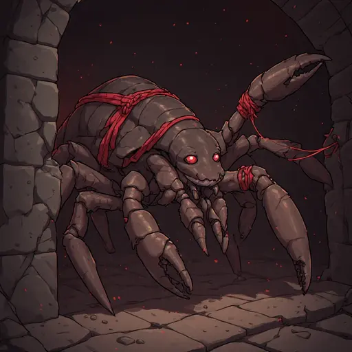
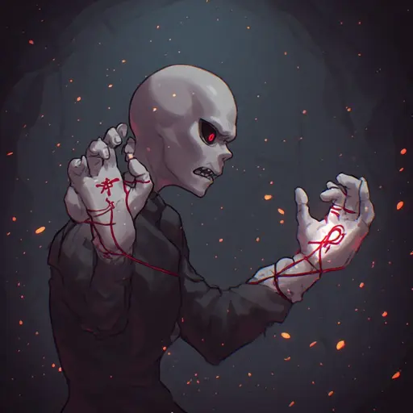
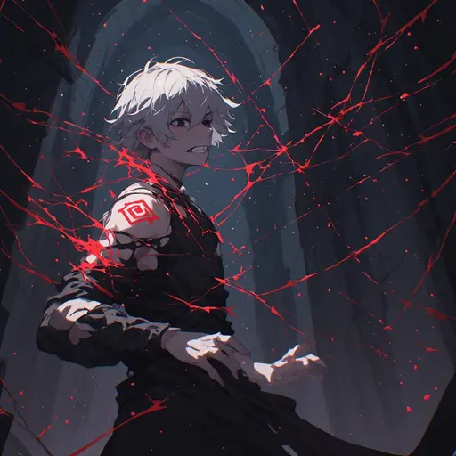

# Merlindrope — kit anime 2.5D

Seis artes aprovadas para Inferno / Magma, com silhueta artrópode própria, carapaça castanho-negra e contenção por fios rituais vermelhos. As composições variam entre movimento lateral, reação do alvo, selo de área e defesa pessoal.

## Retrato

## Cláusula de Prisão

## Grade de Éter

## Porta que Não Abre

## Celas Concêntricas

## Parede de Regras

Proveniência, sementes, hashes e prompts: [manifesto JSON](ART_MERLINDROPE_ANIME_FIRST_COMPLETION_20261029.json).
