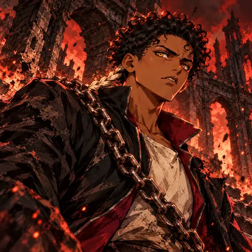
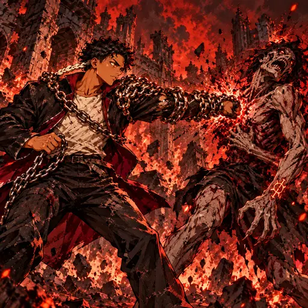
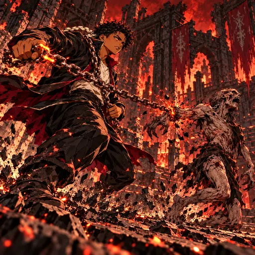
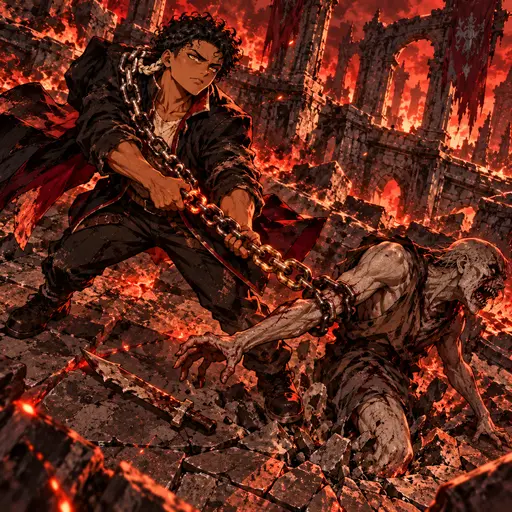
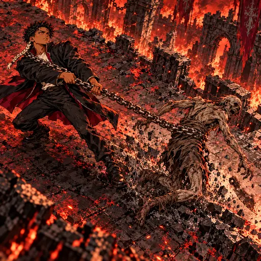
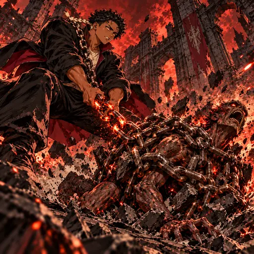
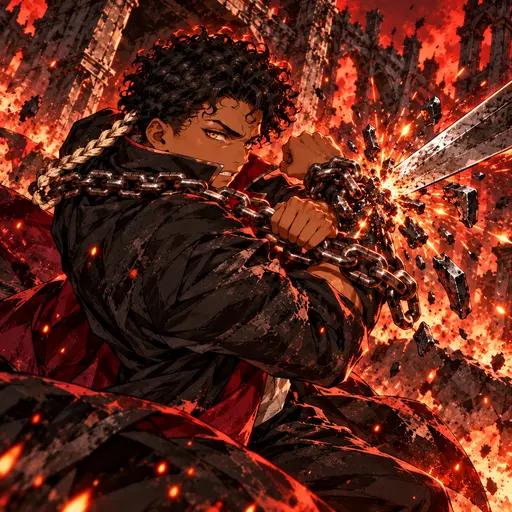

# O Príncipe — direção gráfica dark fantasy 2.5D (2026-10-29)

**Mundo:** Inferno · **Reino:** Magma

## Identidade

Demetrius é um jovem de pele castanha, cachos negros curtos e densos, uma mecha clara trançada junto à orelha e olhos âmbar. Usa casaco escuro de gola alta com forro vinho e uma corrente de ferro contínua sobre o ombro. Não adicionar coroa, máscara, marcas faciais ou outras alterações físicas.

## Direção

Pintura dark fantasy densa e tátil em 2.5D, com pinceladas angulares, contornos manuais, hachuras, sombras de corte e contraste gráfico. A referência informa apenas o tratamento visual; não copiar personagem, tema nem composição. Inferno usa preto, vermelho intenso, vinho e brasas. As correntes são pesadas e físicas, e cada cena mostra uma ação distinta. Sem tecnologia ou maquinaria.

## Kit

- **Retrato:** Demetrius vira cabeça e tronco ao ouvir uma corrente romper atrás dele, entre ruínas do Inferno.
- **Grilhão Herdado (passiva):** após atingir um ghoul marcado, elos se travam no antebraço e no ombro do príncipe, formando uma guarda física.
- **Primeiro Grilhão (impulso):** uma corrente marca o pulso de um condenado e ganha uma carga.
- **Apertar o Grilhão (variação de Primeiro Grilhão):** Demetrius puxa o mesmo grilhão; o alvo perde força e derruba a lâmina. A arte usa a forma `forms.impulso.drag`.
- **Arrasto do Príncipe (técnica):** o puxão lateral atravessa o pátio e desarma o alvo.
- **Cárcere Dinástico (voto):** os elos acumulados formam uma jaula baixa e pesada que atordoa um único ghoul.
- **Corrente Exterior (despertar):** a corrente cruza o antebraço e despedaça uma espada recebida, mantendo Demetrius ileso.

## Galeria

### Retrato

### Grilhão Herdado

### Primeiro Grilhão

### Apertar o Grilhão

### Arrasto do Príncipe

### Cárcere Dinástico

### Corrente Exterior

As sete peças permanecem como candidatas pendentes de aprovação visual.
