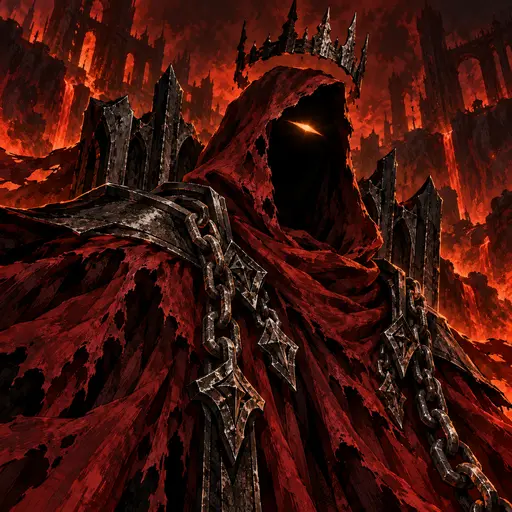
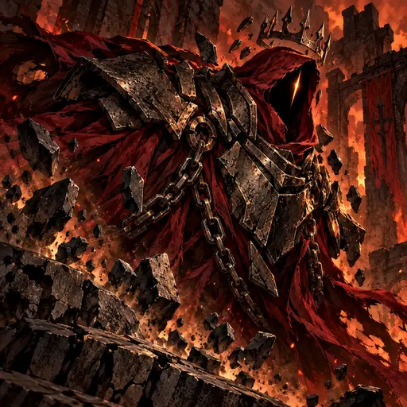
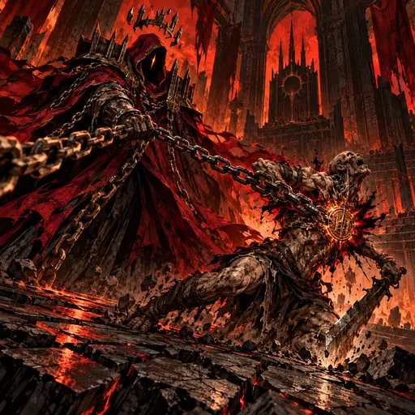
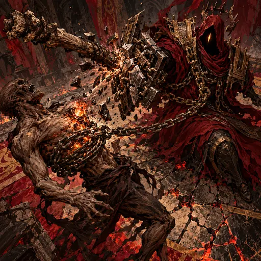
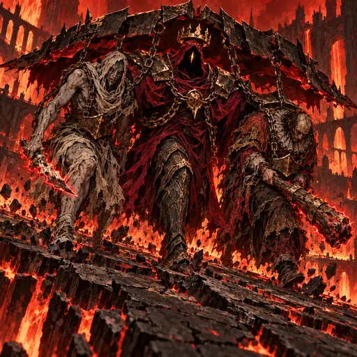
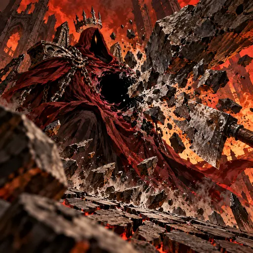

> **Registro histórico.** Nomes, títulos, contagens, regras e direções visuais deste relatório refletem sua etapa de produção. Para o estado vigente, consulte [o índice canônico](PROJECT_CANON.md), [o catálogo atual](CHARACTER_CATALOG.md) e [a direção de arte](ART_DIRECTION.md). IDs e caminhos antigos permanecem por compatibilidade.

# O Suserano — direção gráfica dark fantasy 2.5D (2026-10-29)

**Mundo:** Inferno · **Reino:** Magma

## Identidade

Presença espectral sem corpo visível: capuz negro vazio com uma única fenda âmbar, coroa estreita de ferro partida e flutuante, manto cerimonial negro e vinho rasgado, placas angulares de ferro nos ombros que sugerem o espaldar de um trono e correntes rituais pesadas. Mãos ou manoplas espectrais podem surgir apenas como extensão da corrente durante uma ação.

## Direção

Pintura dark fantasy densa e tátil em 2.5D, com pinceladas angulares, contornos manuais, hachuras, sombras de corte e contraste gráfico. A referência informa apenas o tratamento visual; não se copiam personagem, tema nem composição. Inferno usa preto, vermelho intenso, vinho e brasas. As habilidades se expressam por corrente, ferro, impacto e reação física do ambiente. Sem tecnologia ou maquinaria.

## Kit

- **Retrato:** o capuz vazio, a fenda âmbar, a coroa partida e o manto vinho se deslocam no vento entre ruínas infernais.
- **Autoridade Delegada (passiva):** placas de ferro se assentam sobre o manto após a pressão de um golpe, formando proteção pessoal.
- **Decreto de Submissão (impulso):** uma corrente detém o braço de ataque de um único condenado; o selo de impacto interrompe sua ofensiva.
- **Interdição Soberana (técnica):** o golpe de um ghoul é parado por placas e correntes, e a força retorna contra o atacante, que perde essência e fica exposto.
- **Guarda dos Vassalos (voto):** O Suserano avança com dois vassalos diferentes sob uma cobertura de ferro e correntes; brasas marcam as armas e a ponte cede sob os passos.
- **Suserania Inviolável (despertar):** uma placa de basalto se rompe ao redor do vazio do manto; O Suserano permanece ileso e o chão racha.

As câmeras variam entre close baixo frontal em três quartos, vista lateral oblíqua, ação em perspectiva baixa, perfil próximo, plano frontal amplo e perspectiva através dos escombros. Isso separa a leitura de retrato, defesa pessoal, controle de alvo, contra-ataque, proteção em grupo e despertar.

## Revisão anatômica

O Suserano permanece sem rosto nem corpo humano. Alvos e os dois vassalos aparecem como figuras separadas; membros e articulações visíveis foram conferidos e não apresentam duplicações ou deformações. As seis candidatas seguem pendentes de aprovação visual.

## Galeria

### Retrato

### Autoridade Delegada

### Decreto de Submissão

### Interdição Soberana

### Guarda dos Vassalos

### Suserania Inviolável

As seis peças estão integradas como candidatas e aguardam aprovação visual final.

