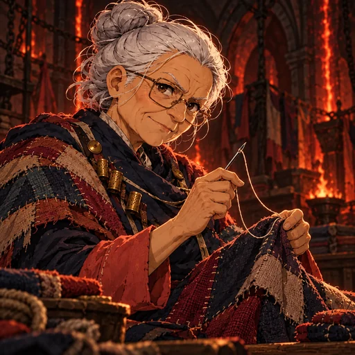
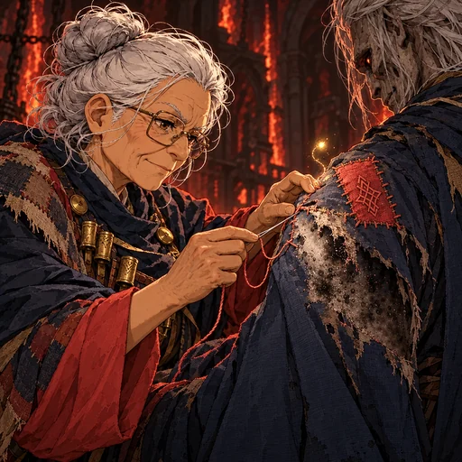
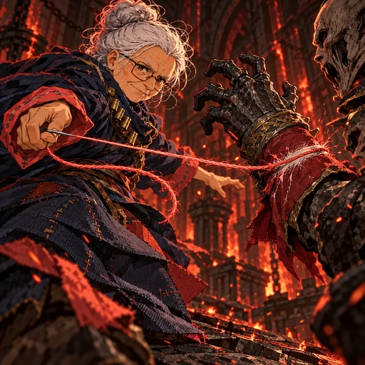
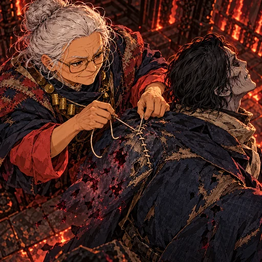
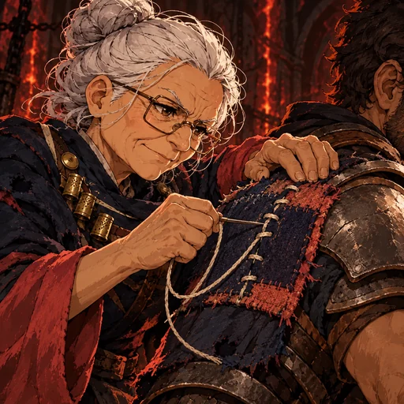
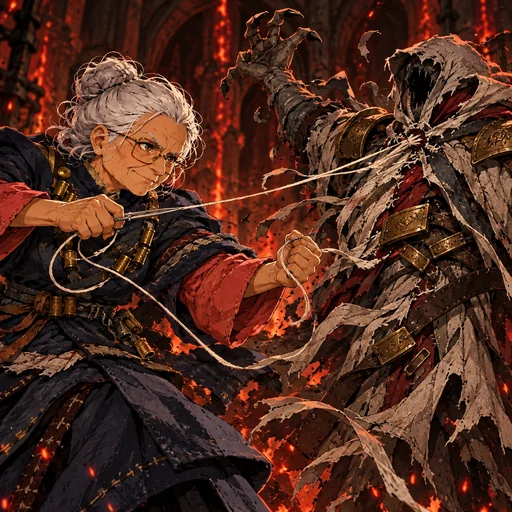
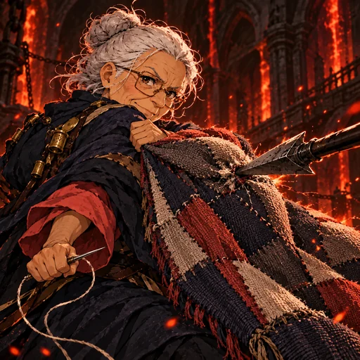

# Sable — A Suturadora

Revisão dark fantasy pictórica em 31/10/2026. Sable mantém o coque prateado, os óculos redondos, o casaco azul-marinho com punhos corais, o xale de retalhos e a agulha de alfaiate. Sete candidatas cobrem retrato, passiva, quatro habilidades-base e a variação dedicada **Reforçar os Pontos**. Ela costura roupas e armaduras de tecido, nunca pele. As imagens estão integradas ao runtime e aguardam aprovação visual; nenhuma mecânica foi alterada.

| Espaço | Cena | Ativo |
|---|---|---|
| Retrato | Alfaiate idosa com óculos, coque prateado e agulha. |  |
| Passiva | Um aliado recebe um remendo protetor e um mote de Graça. |  |
| Ponto de Corte | Agulha e linha cortam a luva armada de um ghoul, sem sangue. |  |
| Sutura de Domínio | Um casaco é reparado e limpo; a costura sustenta o aliado sem tocar a pele. |  |
| Reforçar os Pontos | Remendo espesso reforça o ombro da armadura de tecido; arte exclusiva da variação. |  |
| Desfazer os Pontos | As costuras do casaco externo de um alvo marcado se abrem, sem expor pele. |  |
| Costura de Ausência | O xale bloqueia uma lança e protege Sable. |  |

Fontes JPEG 768×768: `art/source/a-costureira-dark-pictorial-rework-20261031`.

## Prompt set

**Base comum:** Dark fantasy pictorial 2.5D, angular painted contours, hatching, cut shadows, tactile worn cloth and clear needle-and-thread action. Preserve Sable: elderly woman around 75, short sturdy build, warm olive skin, silver curly bun, clear round glasses, navy tailor's coat, coral cuffs, patchwork shawl, one large hand-sewing needle. She repairs garments and cloth armor only; never sew skin. Inferno/Carne colors are charcoal, ember, navy and coral. No gore, extra limbs, text, watermark, scissors, technology, laboratory or generic soldiers.

**portrait:** Three-quarter portrait; Sable holds one hand-sewing needle above a patchwork shawl, glasses and silver bun clearly visible.

**passive:** Repair one allied ghoul's coat with a small defensive patch; a clean Grace mote rises from the repaired cloth.

**impulso:** Ponto de Corte: needle and thread slash one ghoul's armored glove, leaving a mark without blood.

**tecnica:** Sutura de Domínio: close overhead; stitch one allied ghoul's coat, cleanse one stain and heal through clothing only.

**tecnica:remove:** Reforçar os Pontos: a dedicated close composition with a thick cloth patch reinforcing one ally's shoulder armor, distinct from the cleansing image.

**voto:** Desfazer os Pontos: open the outer coat seams of one marked ghoul, exposing no skin.

**despertar:** Costura de Ausência: the shawl blocks one attacker’s spear while Sable's body remains untouched.
