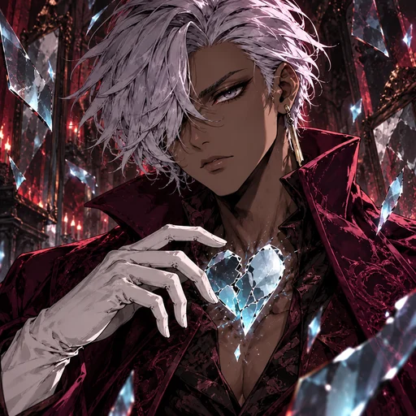
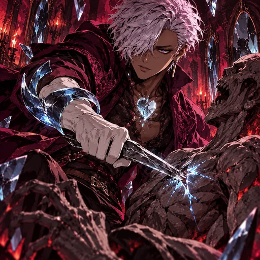
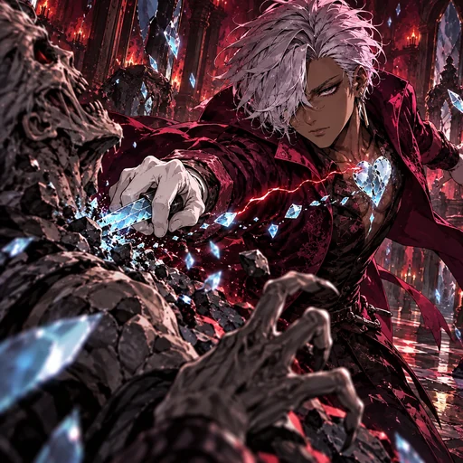
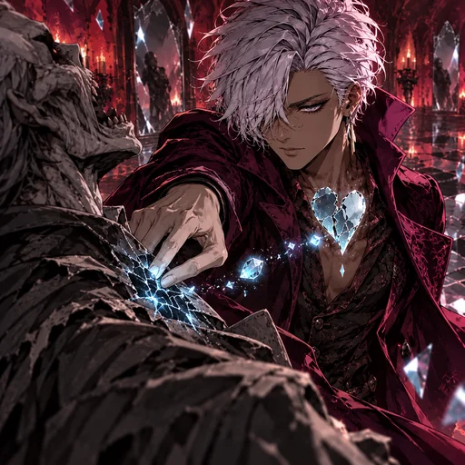
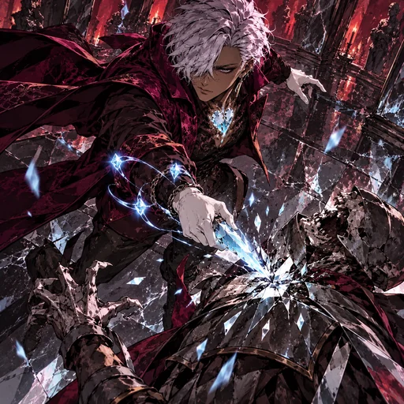
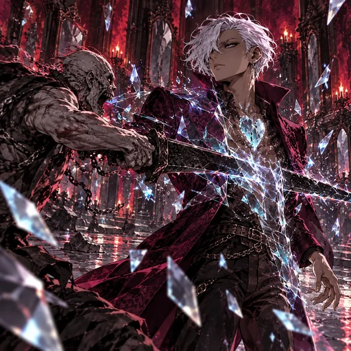

# Desire — O Profanador

Revisão dark fantasy pictórica em 31/10/2026. O conjunto mantém o rosto moreno, o cabelo prateado-lilás cobrindo parcialmente um olho, o casaco borgonha de gola alta e o coração-talismã de cristal azul fraturado. As seis peças foram geradas com OpenAI ImageGen, integradas ao runtime e seguem pendentes de aprovação visual. Mecânicas preservadas.

| Espaço | Cena | Ativo |
|---|---|---|
| Retrato | Close baixo em três quartos; talismã e galeria de espelhos. |  |
| Passiva | Fragmento físico de guarda após perfurar alvo exposto. |  |
| Ímpeto Profano | Perfuração de um ghoul e custo não letal de Vida. |  |
| Contato Invasivo | Marca por contato e extração de um mote de essência. |  |
| Violação da Forma | Três cargas convergem para um único golpe perfurante. |  |
| Forma Intangível | Uma lâmina atravessa a silhueta refratada do personagem. |  |

As cenas usam um oponente por ação individual, não mostram ferimentos gráficos e preservam a pose invasiva e controlada do personagem. Fontes JPEG 768 × 768: `art/source/o-desejo-quebrado-dark-pictorial-rework-20261031`. O conjunto não altera regras de combate.

## Prompt set

**Base comum:** Dark fantasy pictorial 2.5D, angular brushwork, hand-inked contours, hatching, cut shadows, tactile worn fabrics and crystal, natural grounded anatomy, Inferno mirror gallery in black, burgundy, ember red and muted blue. Preserve Tarquinius: adult medium-tan man, short swept silver-lilac hair partly covering one gray eye, dark burgundy high-collar coat, fractured blue crystal-heart talisman; controlled and invasive, not heartbroken. No horns, gore, text, watermark, or generic soldiers.

**Retrato:** Low three-quarter close portrait, hand near the fractured crystal-heart talisman, floating mirror fragments, predatory calm expression.

**Passiva:** After piercing one already exposed ghoul, a small physical shard curves around Tarquinius’s forearm as a guard; readable protective reaction.

**Ímpeto:** Tarquinius pierces one ghoul; a thin red fissure of light leaves his own chest without a wound, showing a nonlethal life cost and a new charge.

**Técnica:** Reverse close view: Tarquinius presses fingers to one ghoul’s sternum, leaves a fractured vulnerability mark, and draws one small essence mote toward the talisman.

**Voto:** High oblique view: one precise piercing strike against one ghoul; three crystal charges converge into the talisman edge at impact.

**Despertar:** Side view: one attacker’s blade passes through Tarquinius’s refracted, partially translucent torso; he stays upright and calm.
