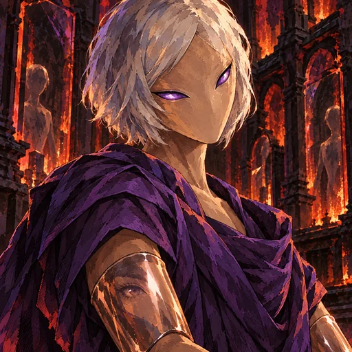
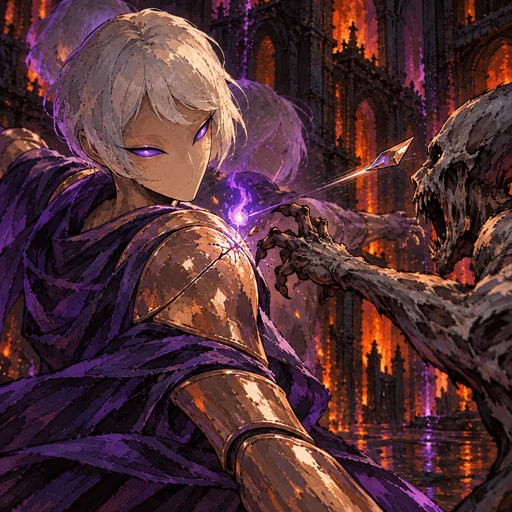
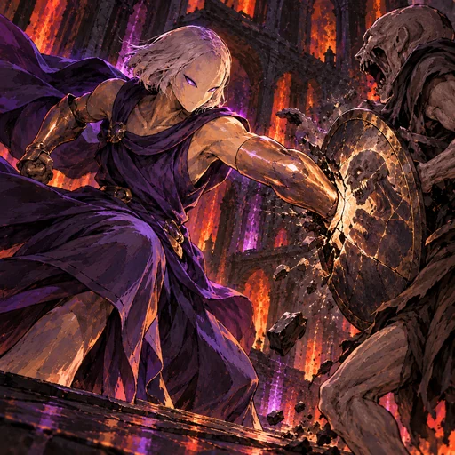
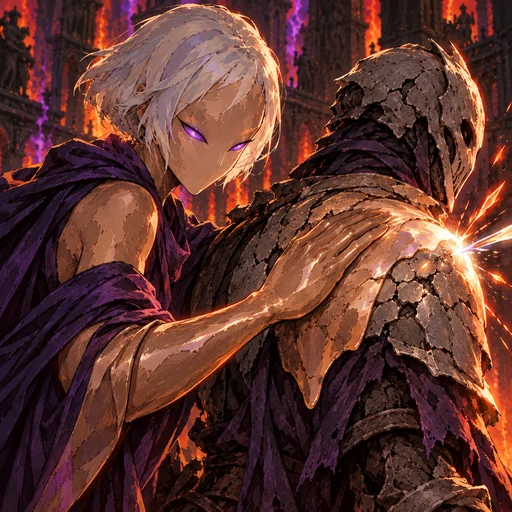
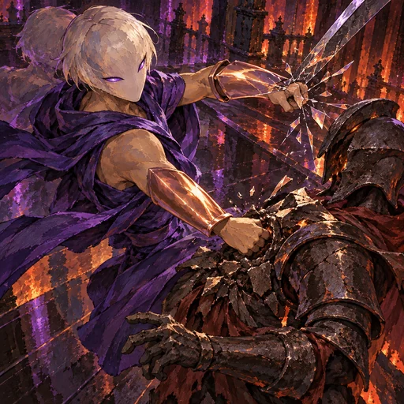
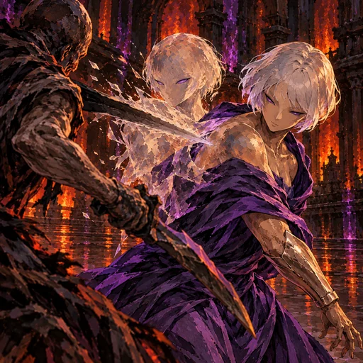

# Echo — O Simulacro

Revisão dark fantasy pictórica em 31/10/2026. Echo mantém a pele de argila marrom-acobreada, o cabelo prateado curto, o robe violeta e as placas polidas nos antebraços. Seis candidatas cobrem retrato, passiva e quatro habilidades-base. As imagens estão integradas ao runtime e aguardam aprovação visual; nenhuma mecânica foi alterada.

| Espaço | Cena | Ativo |
|---|---|---|
| Retrato | Argila acobreada, cabelo prateado e placa polida refletindo o olho. |  |
| Passiva | O golpe de um ghoul racha uma placa; uma lasca reflete o impacto e a essência se solta. |  |
| Molde Vulnerável | Golpe de antebraço contra o escudo de um ghoul, deixando uma marca exposta. |  |
| Vínculo Parasita | Camada de argila sobre a armadura de um aliado para sustentá-lo, sem cobrir pele. |  |
| Romper o Molde | Golpe na imagem refletida para abrir a guarda de um ghoul. |  |
| Duplicata Intangível | A arma atravessa o reflexo estilhaçado; Echo aparece sólido uma única vez. |  |

Fontes JPEG 768×768: `art/source/o-espelho-carnal-dark-pictorial-rework-20261031`.

## Prompt set

**Base comum:** Dark fantasy pictorial 2.5D, angular brushwork, ink contours, hatching and cut shadows. Preserve Echo: adult androgynous clay spirit, smooth copper-brown clay skin, short silver bob, deep-violet draped robe, polished clay forearm plates that reflect ordinary surroundings. Inferno/Carne uses ember red, basalt black and violet. The reflection is a physical surface effect, not a second solid body. Keep one target per single-target action. No gore, extra limbs, text, watermark, technology or generic soldiers.

**portrait:** Low three-quarter close portrait; silver bob, copper-brown clay skin, violet robe and polished clay forearm plate reflecting one normal eye.

**passive:** One ghoul's spiritual strike cracks Echo's clay shoulder plate; a shard reflects back and a small essence mote appears.

**impulso:** Molde Vulnerável: one clay forearm strike against one ghoul's shield leaves an exposed mark.

**tecnica:** Vínculo Parasita: support one allied ghoul through a smooth layer of clay over clothing and armor, never skin.

**voto:** Romper o Molde: break one ghoul's guard by striking its reflection on Echo's forearm plate.

**despertar:** Duplicata Intangível: one ghoul's weapon passes through Echo's fractured reflected afterimage; show one solid Echo only.
