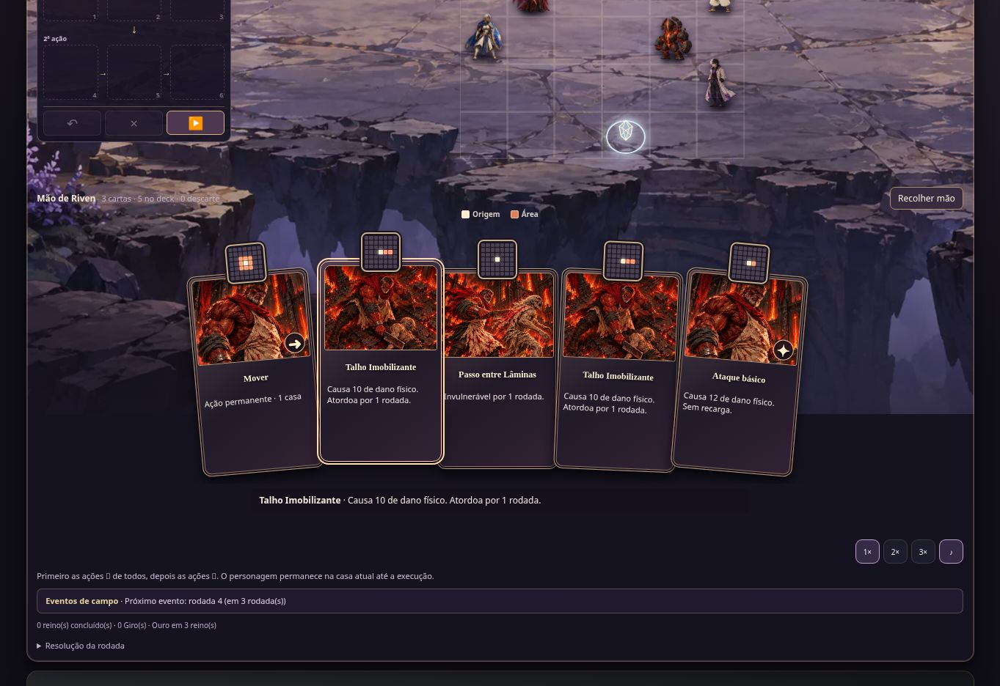
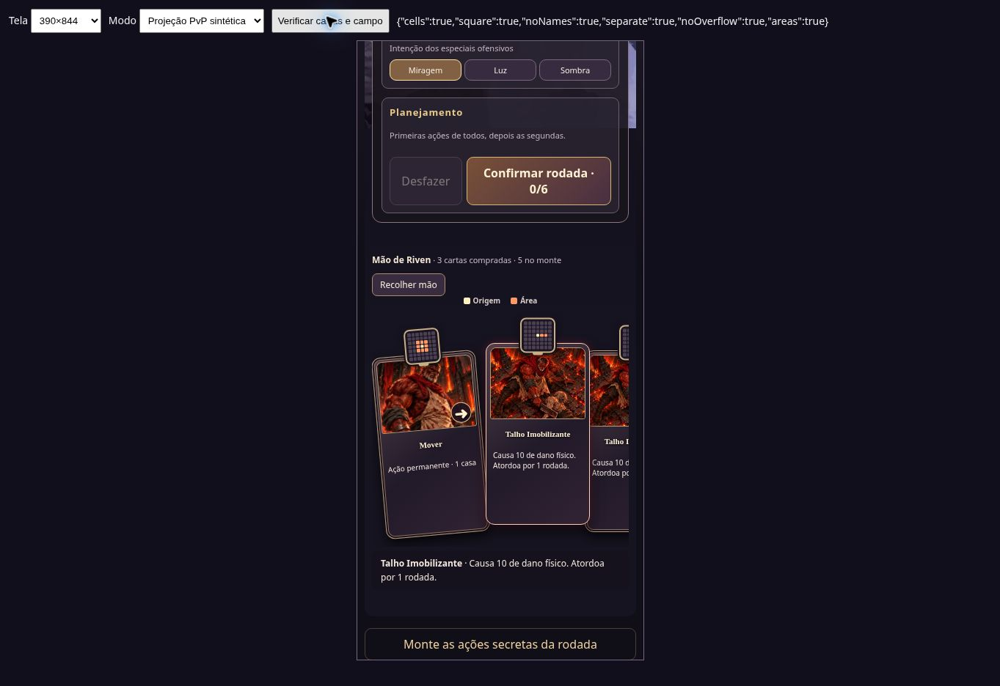

# Cartas legíveis e campo sem nomes — 10/11/2026

## Origem e continuidade

Esta retomada parte da integração remota `37d1e5621d8a4746d61617082b3556df29a32583`, em `fix/compact-card-readability-20261110`. O checkout local anterior não estava disponível; os commits locais até `24cff0d` não foram encontrados no GitHub nem nas cópias disponíveis. O usuário autorizou prosseguir com a base remota.

A continuidade visual do chão e a mão em fluxo abaixo do campo foram reconstruídas a partir do comportamento registrado no chat. Isso **não recupera integralmente** a antiga branch: o deckbuilding entre encontros, as correções de recuperação de conexão e a fila automática de replay daqueles commits ainda precisam de recuperação ou reimplementação separada. A revisão individual pública existente na integração foi mantida. Não é uma substituição do motor atual por laboratório histórico.

Checkout novo inicialmente limpo; sem `package-lock.json` local ou versionado. Nenhuma dependência instalada. Outros checkouts não foram alterados.

## Comportamento entregue

- Removidas as etiquetas visíveis de nomes no campo, tanto no treino quanto no PvP/revisão. Nomes continuam no HUD, nos controles e nos rótulos acessíveis das casas.
- Miniatura de área acoplada ao centro da borda superior de cada carta, com espaço reservado acima do leque. Mobilidade diferencia uma, duas e três casas; a miniatura é uma legenda de padrão em terreno livre, não uma promessa de alvos reais na resolução.
- Descrições compartilhadas entre treino e PvP usam a técnica convertida para combate compacto, seus aprimoramentos aplicáveis e as inscrições da carta. O bônus de dano não substitui a descrição; Preservar, Exaurir, Inicial, conversão de tipo e recarga aparecem separados. A descrição normaliza plural de rodadas sem alterar valores de combate.
- Nome e arte da técnica ativa têm prioridade sobre o nome estático da cópia da carta. Movimento, reação e Ataque Básico usam retrato do dono com símbolo de função; as habilidades mantêm suas artes existentes. Erros de carregamento têm alternativa visual sem ícone de imagem quebrada.
- Texto com quebra de linha nas cartas; descrição completa ao selecionar. Realce de seleção/foco, estados indisponíveis desaturados e carta planejada com borda tracejada. Movimento reduzido desativa transições do novo tratamento.
- Mantidos o campo 6×6, as regras de planejamento, as três mãos independentes e o protocolo privado. Não há mudança de API/servidor.

## Arquivos principais

`src/tactical-card-presentation.js`, `src/tactical-area-diagram.js`, `src/compact-demo.js`, `src/compact-online.js`, `src/tactical-scene-ground.js`, `compact-card-ui.css`, `tactical.html` e `scripts/build.mjs`. Os estilos históricos permanecem; a nova folha é carregada depois e incluída no build.

## Validação

- Testes de apresentação/diagramas/cliente/UI: **27/27**.
- `npm run test:compact`: **43/43**.
- `npm run smoke:compact`: **3 combates, 23 rodadas, 220 eventos, zero erros**.
- `npm run build`: **4381 arquivos**, sucesso.
- `npm test` atual: **694 testes, 563 aprovados, 131 falhas**.
- Base limpa isolada `37d1e56`, no mesmo ambiente: **690 testes, 559 aprovados, 131 falhas**. Os 131 nomes coincidem, sem nomes novos ou removidos. Não se presume que sejam obsoletos.

Classificação das maiores concentrações reproduzidas: formas de técnicas (25), kits reativos (19), smoke da aplicação (11), regras (11), progressão (10), i18n (6), passivas (6), pagamento de recursos (5) e apresentação de trilhas (5). Ainda exigem investigação individual; não foram corrigidas neste escopo de interface.

Chrome desktop e viewports de 390×844 e 320×740: 36 casas, grade quadrada, ausência de nomes visíveis no campo, mão separada e ausência de overflow horizontal da página. No cartão selecionado, medições confirmaram diagrama centralizado, acima da borda, ainda conectado ao corpo e sem recorte pelo contêiner. A quebra de texto foi verificada por estilo computado e captura. Seleção com Espaço, planejamento de uma carta e Desfazer funcionaram; o estado de carta planejada foi removido ao desfazer.

O PvP foi validado visualmente com **projeção pública sintética**, criada pelo adaptador real de batalha em uma fixture isolada. Não houve autenticação real ou duas sessões HTTP de jogadores nesta retomada. A fixture não envia credenciais nem altera dados de contas. Está fora do build. Os testes de protocolo e sigilo foram executados na suíte completa.

Fixtures reutilizáveis: `/tests/fixtures/compact-card-layout.html` e `/tests/fixtures/compact-online-cards.html`.

## Capturas

As capturas são da aplicação real em desenvolvimento, com o PvP explicitamente sintético. Algumas tentativas de captura com recorte falharam no navegador; a captura padrão foi usada como alternativa.

## Limites

Sem novos atlas ou artes geradas. O ajuste de efeitos visuais desta entrega refere-se à apresentação das cartas, não a novas coreografias de combate. Ainda faltam QA físico de toque, navegadores distintos e validação autenticada em duas sessões. Em telas baixas, a página continua rolável para acessar a mão inteira; as cartas não cobrem as casas. Variantes raras continuam restritas conforme a validação já existente na integração.
