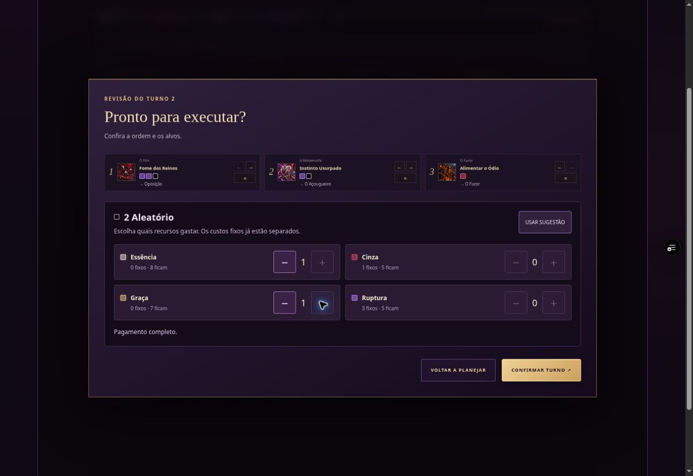

# Transformações e retratos — PMA

O Fim passa a escolher uma manifestação nas três primeiras posições da forma original. Cada manifestação substitui essas três técnicas e o retrato. A quarta posição continua compartilhada: **Fim Inalcançável** custa 1 Qualquer, concede Invulnerável por uma resposta adversária, recupera 10 de Vida e restaura a forma original, com recarga de 4 turnos. A cura respeita Vida máxima e bloqueio de cura; aflições existentes continuam.

“Forma original” significa a manifestação inicial aprovada para este encontro. Não estabelece um corpo verdadeiro nem um rosto canônico para O Fim.

| Manifestação | Função | Técnicas |
| --- | --- | --- |
| Tirano | Marcas, interrupção e guarda | Fenda do Véu; Decreto do Fim; Coroa que Não Cai |
| Predador | Perseguição, roubo de Vida e drenagem | Rastro Faminto; Ceifar o Vínculo; Fome dos Reinos |
| Ruína | Aflições, interdição e pressão coletiva | Cinza de Ninguém; Nome Extinto; Última Fronteira |

Cada transformação custa 1 Éter, concede 8 de Defesa e consome a ação daquela alma. A forma permanece até a defensiva. Não há ação adicional ao assumir um corpo. As recargas continuam ligadas às posições ao retornar ou trocar de manifestação.

A Metamorfa possui três corpos: original, Pele Usurpada e Carapaça Usurpada. As duas transformações trocam as três técnicas e o retrato. Descartar o Molde, Descamar a Armadura e Corpo Substituto restauram o corpo original sem limpar recargas. Pele Usurpada favorece lâmina perfurante e revide; Carapaça favorece guarda e contra-ataque.

O Furor usa um retrato de Ódio Solto durante sua transformação existente, restaurado pelo desfecho ou pela expiração. A Oscilante usa o retrato Contorno de Abrigo até Retomar a Sombra. Suas mecânicas anteriores permanecem.

O Devorador agora mostra Corpo Saciado e Fome sem Corpo. A forma faminta acompanha a transformação automática já existente de Mordida da Alma quando a Vida chega a 50 ou menos; recuperar Vida acima do limiar restaura o retrato. A Máscara Dupla mostra Máscara de Confiança e Máscara da Traição durante Rosto Emprestado. A técnica de contra-ataque recebeu arte própria para a segunda face; a forma retorna quando a duração de 2 turnos termina. Os dois mantêm o tipo de Essência de afinidade original.

O Codex tem seletores de formas que mostram o retrato e o conjunto completo de quatro posições de cada estado. Esses seletores não alteram o combate, o catálogo ou o progresso. No combate, a forma é indicada no nome do personagem e muda somente na resolução da habilidade ou expiração.

A IA calcula o valor do conjunto seguinte a partir do estado público: guarda, inimigos vivos, dano, aflições, controle e recuperação por roubo de Vida. A partir de Ruptura II, concentra ataques em alvos com maior ameaça visível; a partir de Ruptura III, também considera a pressão que pode atingir aliados e valoriza proteção que evita uma queda. Não consulta a fila do jogador nem os sorteios futuros.

## Verificação

Os testes específicos cobrem as três escolhas, as nove técnicas, custos, uma ação por alma, retorno com cura e invulnerabilidade, duração, recargas compartilhadas, limite e bloqueio de cura, estados interrompidos, preservação das definições, expiração de Furor, reversão de Oscilante, ambas as formas de Metamorfa, escolhas contextuais da IA, serialização e os dois clientes do duelo autoritativo.

O cenário `tests/fixtures/forms.html` renderiza o motor e a interface reais em larguras de 320, 360, 390, 768 e 1200 px, com Essência inicial ampliada. Permite conferir transformações e retornos sem ler ou alterar o progresso salvo. Não é uma rota de campanha nem desbloqueia personagens.

As artes novas estão nas pastas versionadas `art/characters/{id}/body-forms-20261023/`. Fontes, prompts de geração e hashes estão em `docs/BODY_FORMS_20261023.json`. Foram criadas pela ferramenta integrada `image_gen.imagegen`, preservando as manifestações e identidades aprovadas. São 24 imagens registradas: retratos base e alternativos para O Devorador e A Máscara Dupla, além da arte de contra-ataque da segunda face.

A verificação anterior no navegador confirmou as transformações de Tirano, Carapaça Usurpada e Ódio Solto, além do retorno dos retratos de O Fim e Metamorfa, Contorno de Abrigo, Pele Usurpada e a escolha de Ruína pela IA. Nesta revisão, os cinco arquivos novos de O Devorador e A Máscara Dupla passaram por validação de dimensão, integridade WebP e hash. Os testes funcionais cobrem a mudança e o retorno dos dois retratos.

## Tipos de Essência por corpo e custo Coringa

| Personagem | Original | Formas |
| --- | --- | --- |
| O Fim | Éter | Tirano: Cinza; Predador: Ruptura; Ruína: Graça |
| Metamorfa | Cinza | Pele Usurpada: Ruptura; Carapaça Usurpada: Éter |
| Furor | Cinza | Ódio Solto: Ruptura |
| Oscilante | Ruptura | Contorno de Abrigo: Graça |
| Devorador | Cinza | Fome sem Corpo: Cinza, ao atingir 50 de Vida |
| Máscara Dupla | Cinza | Máscara da Traição: Cinza, por 2 turnos |

O tipo de Essência principal acompanha o corpo e retorna com ele. O custo Coringa complementa as Essências fixas: cada unidade é paga escolhendo uma entre Éter, Cinza, Graça e Ruptura. Custos complementares das manifestações de O Fim e dos corpos alternativos de Metamorfa usam Coringa. As 100 defesas pessoais e a quarta técnica de O Fim custam exatamente 1 Coringa; 77 personagens também usam esse custo em ao menos uma habilidade normal, preservando o total de pontos e a escala de cada kit.

Coringa aparece como marcador de custo flexível. Não é um tipo de Essência: escolha a quantidade pedida entre Éter, Cinza, Graça e Ruptura. A confirmação reserva primeiro todos os custos fixos da fila, sugere os tipos mais abundantes restantes e oferece controles de menos/mais, saldo preservado e seleção automática. O jogador pode alterar a ordem sem refazer uma escolha de pagamento válida. Remover uma ação recalcula a sugestão. A confirmação fica desabilitada até completar o pagamento.

O motor fixa a escolha por ação na confirmação e só debita quando ela realmente resolve. Atordoamento, queda, mudança da técnica ou perda de alvo não consomem o custo. Drenagem posterior que remova um tipo de Essência escolhido pode impedir a ação, sem trocar silenciosamente o pagamento. No duelo, o servidor recalcula os custos a partir do kit atual e valida a seleção agregada; campos de custo ou pagamento por ação enviados pelo cliente não têm autoridade. A IA também reserva tipos de Essência existentes.

As fichas removem cargos táticos inventados, classes decorativas, palavras-chave e blocos COMBO repetidos. Permanecem lore, passivas reais, descrições dos efeitos, recargas, custos e nomes dos corpos.

### Conferência da interface de pagamento

Prévia verificada: commit remoto `d78b48341fc2dd728851dcf55a7508d3cd6da1ff`. Na fila do segundo turno, Fome dos Reinos, Instinto Usurpado e Alimentar o Ódio reservaram 3 Ruptura e 1 Cinza. As 2 unidades de custo Coringa foram pagas manualmente com 1 Éter e 1 Graça; os saldos após resolução foram 11 Éter, 5 Cinza, 7 Graça e 5 Ruptura, após três sorteios de tipos de Essência. Os retratos mudaram para Predador e Pele Usurpada, com técnicas em Ruptura.

A revisão em 320 px ficou sem transbordamento horizontal: área de conteúdo 303 px, diálogo 283 px e botões de ajuste 44 × 44 px. Retirar uma unidade bloqueou Confirmar; completar com outra cor habilitou o botão. O Codex carregou os retratos e as três artes do Predador, incluindo Rastro Faminto restaurado.

O fluxo normal da campanha também foi conferido: Fortaleza de Luz foi enfileirada com a única unidade inicial de Essência, do tipo Cinza; retirar o pagamento bloqueou a confirmação e mover o foco para o controle disponível preservou o uso por teclado. Enter completou o pagamento e a confirmação executou a defesa, exibindo INVULNERÁVEL.
