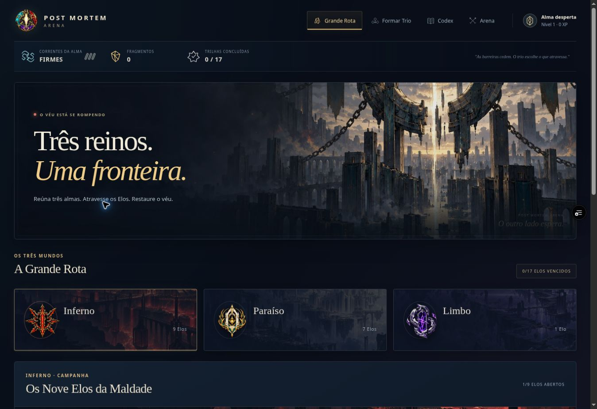
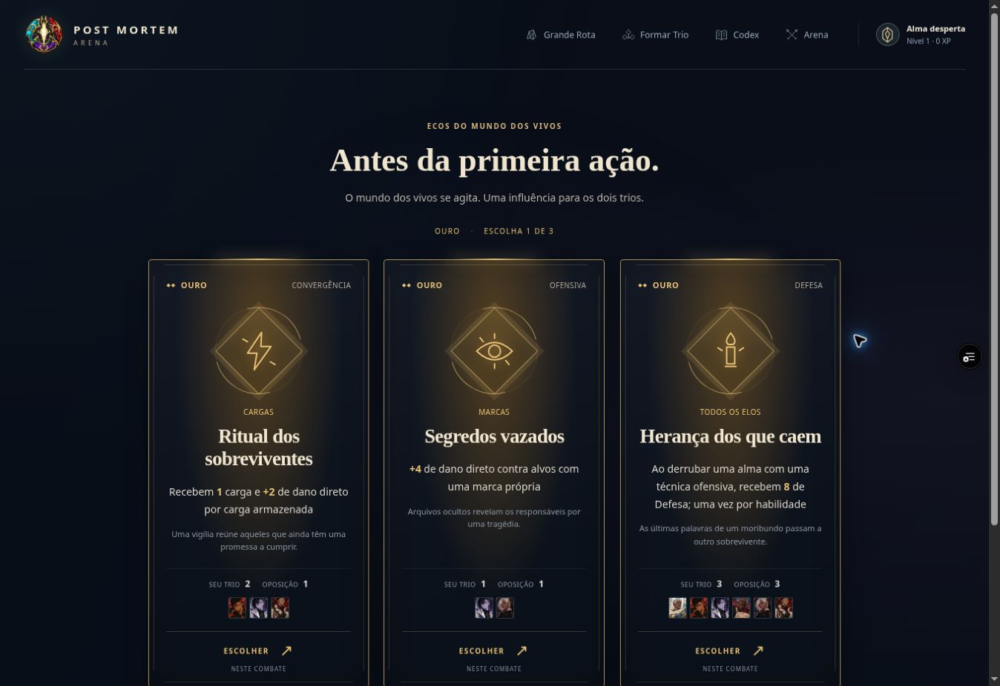

> **Registro histórico.** Nomes, títulos, contagens, regras e direções visuais deste relatório refletem sua etapa de produção. Para o estado vigente, consulte [o índice canônico](PROJECT_CANON.md), [o catálogo atual](CHARACTER_CATALOG.md) e [a direção de arte](ART_DIRECTION.md). IDs e caminhos antigos permanecem por compatibilidade.

# Verificação visual — 21/10/2026

Prévia da branch `feature/combat-trails-20261021`. Artes finais e prompts: [visual-identity.md](visual-identity.md).

- 131 testes de regras e interface passaram. Os testes de presença dos arquivos antigos de arte não são executados nesta cópia parcial do repositório; nenhum asset de personagem foi alterado.
- 28 combinações verificadas no navegador: eventos Prata/Ouro/Prismáticos, Legados, combate, escolha após baixa e Arena, cada uma em 320, 390, 768 e 1200 px.
- Sem rolagem horizontal nessas combinações; sempre três cartas nas telas de escolha e 12 habilidades no combate.
- Habilidades: 48 px de largura em 320/390, 45 px em 768 e 57 px em 1200.
- Mais quatro verificações da aplicação real nas mesmas larguras: navegação com quatro abas e sem overflow. No ajuste final de 320/390, nível e XP visíveis e sem colisão com a marca; barra de progresso com 68 px de altura.
- Menu, Paraíso, seleção de Elo e entrada da Caçada de Sangria testados pela interface real. A partida abriu três eventos Ouro pertinentes às equipes.
- Nenhum erro ou warning da aplicação observado no console do cenário real. Recursos do menu carregados, incluindo a nova arte do portal com 1536 px de largura.
- Classes, imagens e conteúdos de personagens, habilidades e passivas permanecem os do catálogo anterior; os bônus de eventos ficam no motor de modificadores.
- Online global continua dependente de Redis conectado; não foi simulado como serviço ativo.

As capturas abaixo são da aplicação real, sem injeção de estado ou manipulação de progresso. Os testes de variantes de raridade usam fixtures isoladas, identificadas como cenários de verificação.

